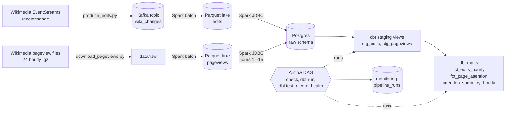
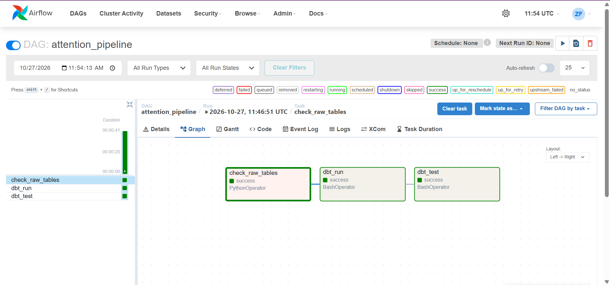
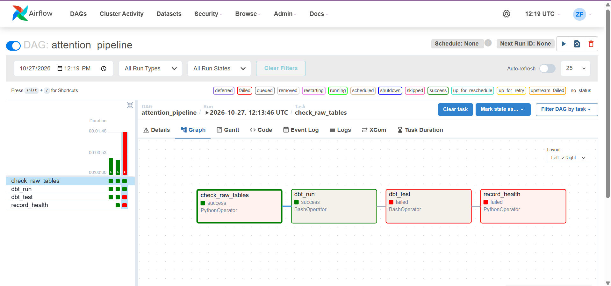

# Wikipedia Attention Platform

A production-style data platform that runs on a laptop. It answers one question:
**do English Wikipedia articles that are being edited get more readers?**

It combines two real Wikimedia data sources, a live-style edit stream and hourly
pageview files, and runs them through Kafka, Spark, Postgres, dbt and Airflow with
automated tests and a health report after every run.

## Result

For the four complete hours 12:00-15:59 UTC on 2026-10-22, pages that were edited in
an hour got roughly **10 to 12 times** more views in that hour than the average
article page:

| Hour (UTC) | Avg views, all article pages | Avg views, edited pages |
|---|---|---|
| 12:00 | 4.57 | 50.06 |
| 13:00 | 4.81 | 58.64 |
| 14:00 | 5.00 | 51.53 |
| 15:00 | 5.07 | 63.18 |

This is a correlation, not a cause. Popular pages attract editors, and edits may also
attract readers. The data cannot tell these apart. See the limitations below.

## Architecture



## Stack

| Tool | Role |
|---|---|
| Kafka (KRaft, single node) | Message log for edit events |
| Spark 3.5 (PySpark, batch, in Docker) | Reads Kafka and the pageview files, writes Parquet, loads Postgres |
| Parquet in a Docker volume | The data lake, partitioned by date and hour |
| PostgreSQL 16 | Warehouse |
| dbt Core 1.11 (dbt-postgres) | Staging views, marts and 18 data tests |
| Airflow 2.10 | Orchestration and monitoring |
| Docker Compose | Local infrastructure |

## Data

- **Edits:** Wikimedia EventStreams `recentchange`, replayed for 6 hours on 2026-10-22
  (501,604 events, 0 duplicates). Only these fields are kept: event id, time, wiki,
  namespace, type, title, bot flag, byte change. **No usernames and no edit comments
  are stored.**
- **Pageviews:** the 24 hourly files for 2026-10-22 (about 1.4 GB compressed, about
  7.2 million lines per hour). Spark keeps English Wikipedia (desktop and mobile):
  49.5 million rows.
- This repository contains no data. Check Wikimedia's own terms before reusing it.

## How the pipeline works

1. `produce_edits.py` replays the edit stream into Kafka. After a dropped connection it
   resumes from the stream's own position (`Last-Event-ID`), not from an event time.
2. `pageviews_to_parquet.py` and `edits_to_parquet.py` (Spark) write Parquet.
   Edits are de-duplicated by `event_id`.
3. `load_to_postgres.py` loads English edits and the pageviews of the 4 complete hours
   into the `raw` schema.
4. dbt builds staging views (flags, no deleted rows) and three mart tables.
5. The Airflow DAG `attention_pipeline` runs: `check_raw_tables`, `dbt_run`, `dbt_test`,
   `record_health`.



## Data quality and monitoring

- 18 dbt tests: not-null, uniqueness, one row per page and hour, desktop plus mobile
  equals total, and edit counts in the marts equal edit counts in staging.
- After every run `record_health` writes a row to `monitoring.pipeline_runs`: task
  states, row counts, the pageview match rate and a healthy or unhealthy status. The
  task fails the run when something is wrong, so a failed test cannot hide behind a
  green run.
- **Failure drill:** I added a test that always fails. The run turned red, the report
  said `unhealthy` with the reason, and after removing the test the next run was
  `healthy` again.



## Honest limitations

- **Laptop scale.** One day of pageviews and 6 hours of edits (4 complete hours
  analysed). Docker is limited to 3 GB, so Spark jobs run one at a time.
- **Replay is not guaranteed.** Wikimedia keeps stream history for a limited time, so
  the edit backfill for 2026-10-22 may not be reproducible later.
- **Pageview match is imperfect.** The pageview files appear to list only pages that
  were viewed, so a missing row is counted as 0 views. 62% of edited page-hours match a
  row. 74% of the rest belong to pages that do appear in another hour. About 10% of
  edited page-hours belong to pages absent from all four hours: nobody read them, or the
  titles differ. The data cannot tell which.
- **Airflow runs the dbt and monitoring part only.** The Kafka and Spark steps are run
  by hand with the scripts, because Airflow in a 3 GB limit cannot also launch Spark
  containers. The DAG is manual, since the data is a fixed window.
- **No alert delivery.** A problem shows as a red run and an `unhealthy` row; nothing
  sends an email or message.
- **Local Parquet, not cloud storage.** MinIO's open-source repository is archived, so
  the lake is plain Parquet in a Docker volume.
- **Correlation only**, as described above.

More detail on each choice is in [docs/decision_log.md](docs/decision_log.md).

## How to run it (Windows with Git Bash and Docker Desktop)

```bash
cp .env.example .env              # then set POSTGRES_PASSWORD
docker compose up -d              # Kafka and Postgres
python download_pageviews.py 2026-10-22
python produce_edits.py 2026-10-22T11:55:00Z 2026-10-22T16:05:00Z
python check_topic.py             # expect 0 duplicates
docker stop cap_broker            # free memory for Spark
bash run_pageviews.sh
docker start cap_broker && bash run_edits.sh
bash run_load.sh
docker compose -f docker-compose.yml -f docker-compose.airflow.yml up -d airflow
bash sync_airflow.sh
docker exec cap_airflow airflow dags unpause attention_pipeline
docker exec cap_airflow airflow dags trigger attention_pipeline
```

In Git Bash run `export MSYS_NO_PATHCONV=1` first, otherwise container paths get
rewritten.

## Repository layout
docker-compose.yml Kafka and Postgres
docker-compose.airflow.yml Airflow
produce_edits.py edit stream to Kafka
download_pageviews.py resumable pageview downloader
check_topic.py topic check: counts and duplicates
pageviews_to_parquet.py Spark: pageviews to Parquet
edits_to_parquet.py Spark: Kafka to Parquet
load_to_postgres.py Spark: Parquet to Postgres
run_*.sh, sync_airflow.sh helper scripts
dags/attention_pipeline.py Airflow DAG
dbt_attention/ dbt project: models, tests
docs/ decision log and screenshots

